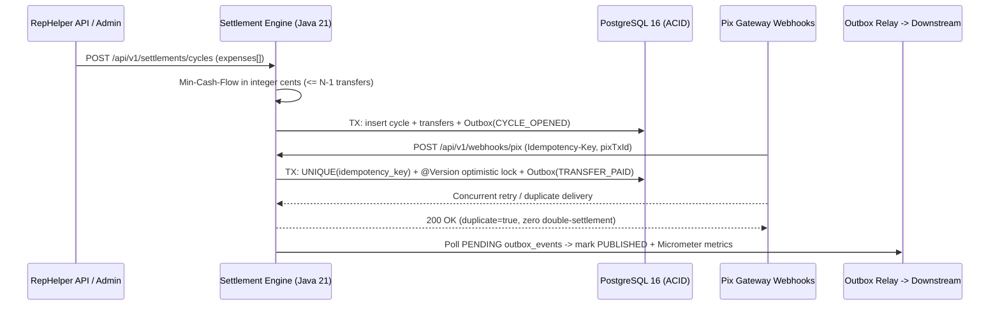

# rep-helper-settlement-engine

[](https://github.com/leosaponisouza/rep-helper-settlement-engine/actions/workflows/ci.yml)
-ED8B00?style=flat-square&logo=openjdk&logoColor=white)


[](https://github.com/leosaponisouza/sdd-spring-guardrails)
[](LICENSE)

Financial settlement microservice for the [**RepHelper**](https://github.com/leosaponisouza/rep-helper) ecosystem, built on **Java 21 (Virtual Threads)** and **Spring Boot 3.4.3**.

At month-end, shared student households accumulate dozens of cross-paid bills (rent, electricity, groceries, internet). Instead of $O(N^2)$ pairwise reimbursements, this service computes the **mathematically minimal Pix transfer graph (`Min-Cash-Flow`)**, processes **concurrent/retried Pix payment webhooks with exact-once idempotency**, and publishes downstream integration events via a **Transactional Outbox**.

---

## Architecture & Concurrency Model



### Engineering Highlights

| Capability | Implementation |
|---|---|
| **Min-Cash-Flow Simplification (`DebtSimplificationEngine`)** | Operates strictly in integer cents (`long`) with deterministic remainder allocation so $\sum \text{balances} = 0$ holds without floating-point drift, collapsing transitive/circular debts to at most $N - 1$ Pix transfers in $O(N \log N)$. |
| **Exact-Once Pix Webhook Idempotency (`PixWebhookService`)** | Combines a `UNIQUE(idempotency_key)` receipt ledger (`webhook_receipts`) with JPA `@Version` optimistic locking inside isolated `REQUIRES_NEW` transactions. Verified against **20 concurrent Virtual Threads** hitting the same `pixTxId` simultaneously (`1` settled, `19` deduplicated `200 OK`). |
| **Transactional Outbox (`OutboxRelayService`)** | Eliminates dual-write anomalies between database state (`PAID` / `SETTLED`) and event publication (`SETTLEMENT_CYCLE_OPENED`, `SETTLEMENT_TRANSFER_PAID`, `SETTLEMENT_CYCLE_SETTLED`). |
| **Observability (`Micrometer` + `Prometheus`)** | Exposes domain counters (`settlement.transfers.paid`, `settlement.webhooks.deduplicated`, `settlement.outbox.published`) via `/actuator/prometheus`. |
| **Executable SDD Guardrails** | Enforces [`SPEC-001`](docs/specs/SPEC-001-settlement-and-outbox.md) traceability and boundary rules at test time via [`sdd-spring-guardrails`](https://github.com/leosaponisouza/sdd-spring-guardrails). |

---

## API Overview

| Method & Path | Purpose |
|---|---|
| `POST /api/v1/settlements/cycles` | Computes Min-Cash-Flow plan for `(republicId, referenceMonth)` and opens Pix transfers |
| `GET /api/v1/settlements/cycles/{cycleId}` | Returns cycle status (`OPEN` / `SETTLED`), reduction metrics, and transfer statuses |
| `POST /api/v1/webhooks/pix` | Idempotent Pix settlement callback (`Idempotency-Key` header required) |
| `POST /api/v1/settlements/outbox/relay` | Relays pending transactional outbox events in FIFO order |
| `GET /actuator/prometheus` | Prometheus metrics endpoint |

---

## Verification

```bash
mvn -B test
```

Covers:
1. **`ArchitectureGuardrailsTest`** — verifies `@SpecContract` -> `docs/specs/SPEC-001-settlement-and-outbox.md` traceability, zero `@Entity` leaks, `OffsetDateTime` contracts, and `@Valid` boundaries.
2. **`DebtSimplificationEngineTest`** — verifies $N - 1$ upper bound on circular graphs and exact 1-cent remainder conservation (`R$ 100.00 / 3`).
3. **`SettlementConcurrencyAndOutboxIntegrationTest`** — fires 20 concurrent Java 21 Virtual Threads against `/api/v1/webhooks/pix` to prove exact-once settlement, automatic cycle closure, and atomic Outbox relay.

---

## License

Released under the [MIT License](LICENSE).
